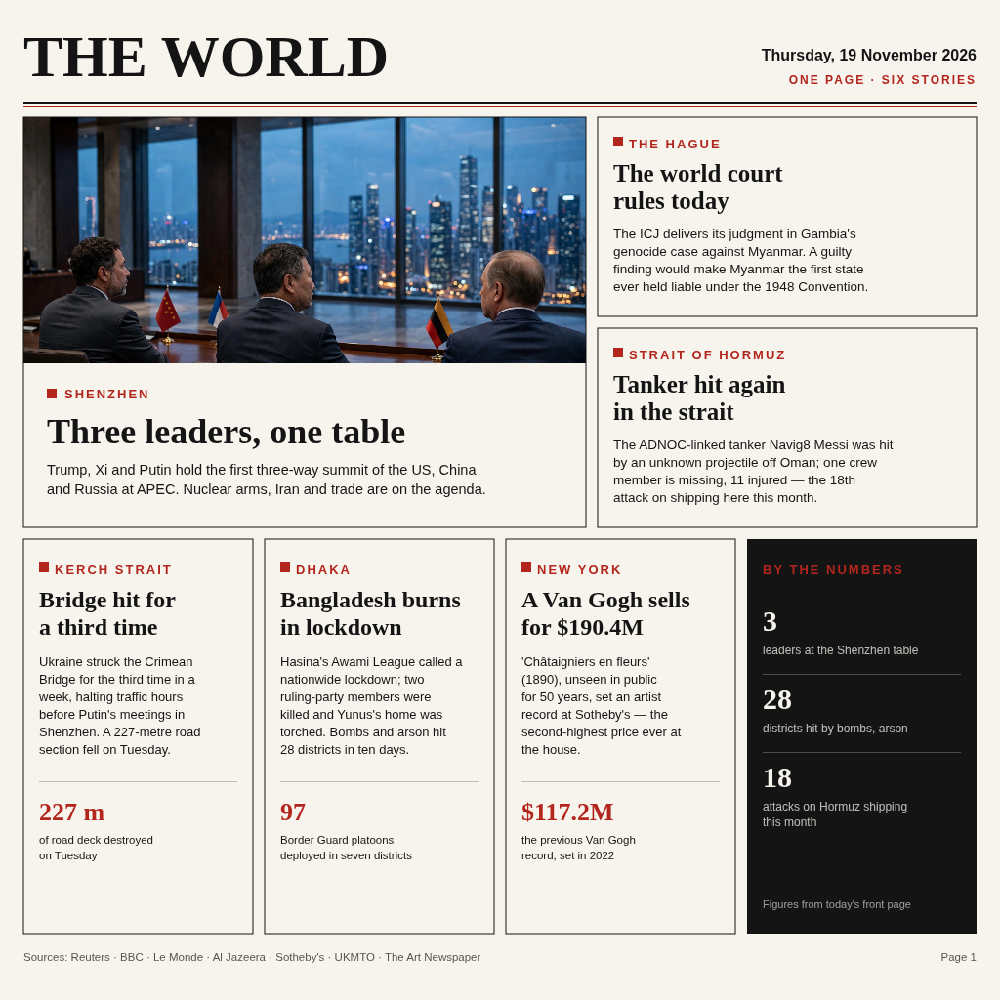

# THE WORLD — 19 November 2026

[](https://make.fun/c/news-image-20261119)
[](https://make.fun/c/news-image-20261119)
[](https://make.fun/c/news-image-20261119)

One image that sums up 19 November 2026 — a single-page front page, six stories,
built by a deterministic program.



## The six stories

1. **Shenzhen — "Three leaders, one table"**
   Trump, Xi and Putin hold the first-ever three-way summit of the US, China and
   Russia on the APEC sidelines. Nuclear arms, Iran and trade are on the agenda.
   Sources: Reuters, USA Today, Le Monde, BBC.
2. **The Hague — "The world court rules today"**
   The ICJ delivers its judgment in Gambia v. Myanmar, the Rohingya genocide
   case, at 10:00 at the Peace Palace. A guilty finding would make Myanmar the
   first state ever held liable under the 1948 Genocide Convention.
   Sources: ICJ, Reuters.
3. **Strait of Hormuz — "Tanker hit again in the strait"**
   The ADNOC-linked tanker Navig8 Messi was hit by an unknown projectile off
   Oman; one crew member is missing, 11 injured — the 18th attack on shipping
   here this month. Sources: UKMTO, NY Post, Splash247.
4. **Kerch Strait — "Bridge hit for a third time"**
   Ukraine struck the Crimean Bridge for the third time in a week, halting
   traffic hours before Putin's meetings in Shenzhen. A 227-metre road section
   fell on Tuesday. Source: Reuters.
5. **Dhaka — "Bangladesh burns in lockdown"**
   Hasina's Awami League called a nationwide lockdown; two ruling-party members
   were killed and Yunus's home was torched. Bombs and arson hit 28 districts
   in ten days. Source: Reuters.
6. **New York — "A Van Gogh sells for $190.4M"**
   "Châtaigniers en fleurs" (1890), unseen in public for 50 years, set an
   artist record at Sotheby's — the second-highest price ever at the house.
   Sources: Reuters, Sotheby's, The Art Newspaper.

By the numbers: **3** leaders at the Shenzhen table · **28** districts hit by
bombs and arson · **18** attacks on Hormuz shipping this month.

## How the image is made

`main.py` is a deterministic, stdlib-only Python program. It takes the AI-made
hero photograph (`assets/hero.png`, no text in it) and the sharp text layer
(`assets/text.png`, rendered from `assets/text.svg`), composites them, and
writes one 1024×1024 PNG to `/output/entry.png`. No network access, no
randomness — two runs produce byte-identical output.

```sh
python3 main.py          # writes /output/entry.png
MAKEFUN_OUTPUT_DIR=. python3 main.py   # write entry.png here instead
```

## Layout

Bento front page: one large lead tile (Shenzhen summit + hero photo), five
story tiles, one stat tile. Mono-hot palette — paper `#F7F4ED`, ink `#141414`,
one hot red `#B3261E`; serif-editorial headlines (Liberation Serif Bold),
Liberation Sans body.

## License

MIT — see [LICENSE](LICENSE).
